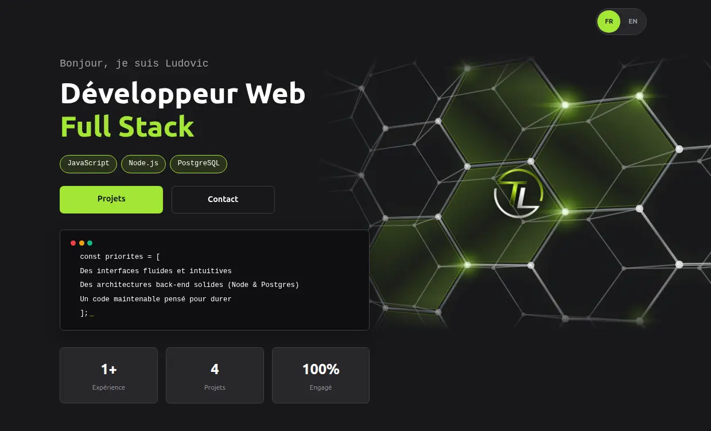

# 🚀 Portfolio de Ludovic Trichereau


Portfolio bilingue de **Ludovic Trichereau**, développeur web Full Stack. Le site présente son profil, ses compétences et ses projets à travers une interface responsive avec des démonstrations vidéo.

**🎯 Audit du site** : 14/11/2026 — score global **17/20**  
*Cette note correspond à une évaluation qualitative, pas à une certification.*

**✅ Contenu du site** :

- Présentation, compétences et quatre projets
- Versions française et anglaise
- Formulaire de contact traité par Formspree
- Mentions légales, politique de confidentialité et page 404
- Site statique publié avec GitHub Pages

---

## 🔄 Évolution depuis la V1

La V2 reprend la structure du site précédent mais améliore plusieurs points essentiels :  
styles mieux organisés, traductions séparées en JSON, identité visuelle plus cohérente, cartes projets interactives, icônes SVG intégrées et scripts dédiés pour la vérification du site.  
Le thème clair/sombre suit désormais les préférences système, remplaçant le bouton manuel de la V1.

---

## ⭐ Résultats de l'audit (14/11/2026)

| Axe | Résultat |
| ----- | ---------- |
| Accessibilité | 17/20 |
| Expérience utilisateur | 18/20 |
| Performance | 19,5/20 |
| SEO | 15/20 |
| Maintenance | 16/20 |
| Confidentialité et pages légales | 14/20 |
| **Score global** | **17/20** |

Les rapports Lighthouse examinés indiquent 99 en performance mobile et 100 sur ordinateur. Ces mesures ont été réalisées en local et ne constituent pas une mesure de la version publiée. Les limites et recommandations sont détaillées dans le rapport d'audit.

📊 **Métriques du site actuel** :

| Type | Fichiers | Détails |
| ------ | ---------- | --------- |
| Pages HTML | 4 | Accueil, pages légales et page 404 |
| Styles CSS | 5 | Styles partagés et styles de page |
| Scripts JavaScript | 3 | Interactions et gestion des langues |
| Scripts Python | 2 | Synchronisation des statistiques et validation |
| Traductions | 2 | Français et anglais |
| Vidéos de démonstration | 5 | Aperçus des projets |

✅ **Validation** :

- `validate-site.py` contrôle les traductions, les clés utilisées, les identifiants, les références locales et le sitemap.
- `sync-stat-boxes.py` synchronise les compteurs de projets et d'expérience affichés dans le HTML.
- Il n'y a pas de suite de tests automatisés de l'interface.

---

## 🌟 Points forts du projet

### 🏗️ Site statique

Pages HTML, styles CSS et scripts JavaScript organisés en ressources statiques, adaptés à une publication sur GitHub Pages.

### 🌍 Présentation bilingue

Le contenu de l'accueil et des pages légales est disponible en français et en anglais, avec des catalogues de traduction dédiés.

### 🧪 Outils de validation

Des scripts Python vérifient les références locales et les traductions, et évitent que les statistiques de l'accueil deviennent obsolètes.

### 🎨 Projets et démonstrations

Quatre réalisations sont présentées avec leurs catégories, technologies et, pour plusieurs d'entre elles, des aperçus vidéo.

### ♿ Accessibilité et responsive

Le site comporte des libellés accessibles, des interactions au clavier et une mise en page conçue pour les écrans mobiles. L'audit signale également des améliorations possibles, notamment pour le menu mobile et la réduction des animations.

### 🔐 Formulaire et confidentialité

Le formulaire de contact est transmis à Formspree. Le site mémorise le choix de langue dans le stockage local du navigateur et ne charge pas de traceur d'audience.

---

## 🧩 Problèmes rencontrés et solutions

> [!WARNING]  
> ⚠️ **Samsung Internet — mode sombre forcé**  
> L’option *« Forcer mode sombre pour contenu Web »* recolorait le site.  
> Sur la page 404, le gris de l’illustration disparaissait et un flash blanc apparaissait au début de l’animation.  
>
> **✔️ Solution / état actuel**  
> L’illustration est désormais servie comme **WebP animée transparente** dans `404.html` plutôt que comme SVG affiché directement.  
> Le visiteur peut aussi désactiver le forçage dans Samsung Internet ; `color-scheme` seul ne l’empêche pas.

---

> [!NOTE]  
> 🧪 **CLS bureau signalé à 0,353 par PageSpeed**  
> Ce décalage n’a pas été reproduit sur la page publiée.  
> Des mesures avec `PerformanceObserver` entre 1280 et 1440 px ont relevé un CLS de 0 à environ 0,001.  
>
> **✔️ Solution / état actuel**  
> Aucun changement de mise en page n’a été appliqué sans cause reproductible.  
> Relancer PageSpeed lorsque le quota est disponible et examiner le problème s’il réapparaît.
---

## 🛠️ Stack technique

### Front-end

- **HTML5**
- **CSS3**
- **JavaScript** sans framework
- **WebP**, SVG et vidéos MP4 pour les ressources visuelles

### Langues

- Français et anglais via les fichiers JSON dans `Public/locales/`
- Choix de langue mémorisé dans le `localStorage` du navigateur

### Hébergement et contact

- **GitHub Pages** pour la publication du site statique
- **Formspree** pour le traitement du formulaire de contact

### Projets présentés

Les projets présentés utilisent différentes technologies, dont **Node.js**, **Express**, **PostgreSQL** et **JWT**. Ces technologies décrivent les réalisations présentées et non le mécanisme de publication de ce site statique.

### Validation

- **Python 3** pour les scripts de validation et de synchronisation
- Aucun gestionnaire de paquets ni commande npm n'est requis pour le site

---

## 🖼️ Illustrations

- 📂 Arborescence du projet

```text
TRICHEREAUludovic.github.io/
├── Public/
│   ├── css/                         # Feuilles de style
│   ├── img/                         # Images et illustrations
│   ├── js/                          # Scripts du site
│   ├── locales/                     # Traductions FR/EN
│   └── video/                       # Démonstrations des projets
├── conception/                      # Audit et documents de conception
├── scripts/                         # Outils de validation Python
├── site perso_v1 backup/            # Sauvegarde de la version précédente
├── 404.html                         # Page d'erreur 404
├── index.html                       # Page d'accueil
├── mentions-legales.html            # Mentions légales
├── politique-confidentialite.html   # Politique de confidentialité
├── robots.txt                       # Directives pour les robots
└── sitemap.xml                      # Sitemap du site
```

## ✅ Accueil

<div align="center">
  
</div>

---

## 🚀 Commandes disponibles

Python 3 est requis pour lancer les scripts. Depuis la racine du dépôt :

```bash
# Vérifier les traductions, références locales et le sitemap
python3 scripts/validate-site.py

# Vérifier que les compteurs affichés sont à jour
python3 scripts/sync-stat-boxes.py --check

# Mettre à jour les compteurs si nécessaire
python3 scripts/sync-stat-boxes.py
```

---

## ▶️ Voir mon portfolio

<https://trichereauludovic.github.io/>

---

## 👥 Contributeur(s)

👨 **Ludovic Trichereau** — Développeur Web Full Stack

## ⚖️ Licence

© 2026 Trichereau Ludovic. Tous droits réservés.  
*Aucune partie de ce projet ne peut être copiée, modifiée ou redistribuée sans autorisation explicite.*
